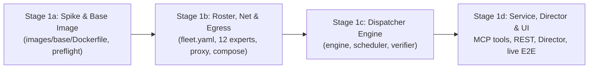

# WAVE 1 ORCHESTRATION: FLEET CORE (STAGES 1a -> 1b -> 1c -> 1d)
## Sub-Orchestrator Execution: Core Fleet Architecture & Engine

**Applicability:** Stages 1a, 1b, 1c, 1d executed in sequential sub-waves.  
**Base Repository:** `/home/john/Projects/The-Agency/`  
**Prerequisite:** Wave 0 merged into `main` with `make accept STAGE=0` passing.

---

## 1. Wave Architecture & Stage Dependency Chain

Wave 1 constructs the entire containerized OpenCode v2 fleet and Dispatcher engine:

Each stage operates on its own dedicated worktree, executes the full Triad, is verified by the Drift Reviewer, and merges into `main` before the next stage starts.

---

## 2. Stage Execution Details

### Sub-Wave 1A: Spike and Base Image (`stage-1a-spike-and-base-image.md`)
- **Branch:** `stage-1a-spike` in `worktrees/wave-1a-spike/`
- **Focus**:
  - Run the 15 preflight spike tests on OpenCode v2 (credentials, proxy env, hot reload, session wait, `/api/info`).
  - Build `images/base/Dockerfile` (pinned to `ghcr.io/anomalyco/opencode:2.0.26` digest, glibc, non-root `agent:agent`, git, ripgrep, Bun, toolchains).
  - Write acceptance checks in `scripts/accept/1a/*.sh`.
- **Triad Execution**:
  1. *Programmer*: Implements spike tests, `images/base/Dockerfile`, and `docs/reports/stage-1a.md`.
  2. *QA*: Runs `make check`, builds the Docker base image, runs `make accept STAGE=1a`, and performs red-proof sabotage.
  3. *Drift Reviewer*: Follows `verify-stage.md`, verifies image non-root user and digestion pin, emits `stage-1a-verification.md` with `VERDICT: PASS`.
- **Merge**: Merge `stage-1a-spike` into `main`.

---

### Sub-Wave 1B: Roster, Network & Egress (`stage-1b-roster-network-egress.md`)
- **Branch:** `stage-1b-roster` in `worktrees/wave-1b-roster/`
- **Focus**:
  - Authoritative `fleet.yaml` declaring all 12 core experts (`director`, `scout`, `architect`, `product`, `frontend`, `backend`, `dba`, `platform`, `security`, `qa`, `reviewer`, `docs`).
  - Configuration renderer generating per-expert `opencode.json` (read-only mounts, `OPENCODE_DISABLE_PROJECT_CONFIG=1`, no `ask` rules).
  - Hardened Docker Compose stack (`compose.yaml`): only the gateway publishes on `127.0.0.1`, internal bridge network, egress proxy allowlist (`opencode.ai`, npm, GitHub), `:z` SELinux flags.
  - Acceptance checks in `scripts/accept/1b/*.sh`.
- **Triad Execution**:
  1. *Programmer*: Implements `fleet.yaml`, renderer, compose, egress proxy, and report.
  2. *QA*: Runs `make check`, starts compose stack, verifies health of all 12 experts over `/api/info`, runs `make accept STAGE=1b`, and conducts red-proofs.
  3. *Drift Reviewer*: Follows `verify-stage.md`, verifies zero published ports on experts, audit defect guards D-07, D-19, D-20, emits `VERDICT: PASS`.
- **Merge**: Merge `stage-1b-roster` into `main`.

---

### Sub-Wave 1C: Dispatcher Engine (`stage-1c-dispatcher-engine.md`)
- **Branch:** `stage-1c-engine` in `worktrees/wave-1c-engine/`
- **Focus**:
  - Dispatcher state machine (`dispatcher/src/engine.ts`): durable mission states, worktree creation/destruction, and task lifecycle (`pending`, `ready`, `running`, `waiting-human`, `done`, `failed`, `cancelled`).
  - Verifier (`verifier/src/verify.ts`): runs declared repo checks, saves artifacts, enforces non-LLM mechanical pass.
  - Landing engine: `--no-ff` merge to mission integration branch, verified again post-merge.
  - Proven against both the fake OpenCode server and live expert instances.
- **Triad Execution**:
  1. *Programmer*: Implements engine, verifier, landing, unit tests, and report.
  2. *QA*: Runs `make check`, runs `make accept STAGE=1c`, and proves red-proof sabotage.
  3. *Drift Reviewer*: Follows `verify-stage.md`, verifies D-01, D-02, D-05, D-11, D-12 are resolved (no `cmd: "true"`!), emits `VERDICT: PASS`.
- **Merge**: Merge `stage-1c-engine` into `main`.

---

### Sub-Wave 1D: Service, Director & Dashboard (`stage-1d-service-director-dashboard.md`)
- **Branch:** `stage-1d-director` in `worktrees/wave-1d-director/`
- **Focus**:
  - Expose Dispatcher via MCP (`fleet_dispatch`, `fleet_wait`, `fleet_result`, `fleet_diff`) for the Director expert.
  - REST control plane & SSE event stream.
  - Caddy host routing (`director.agency.localhost`, `agency.localhost`).
  - Web dashboard (live SSE transcripts, task board, diffs).
  - Canonical live end-to-end mission verification test.
- **Triad Execution**:
  1. *Programmer*: Implements MCP server, REST API, dashboard, Caddy config, and live E2E mission test.
  2. *QA*: Runs `make check`, boots full fleet, executes live E2E mission, runs `make accept STAGE=1d`, and performs red-proof sabotage.
  3. *Drift Reviewer*: Follows `verify-stage.md`, audits E2E test to confirm it fails when server is down or tokens invalid, emits `VERDICT: PASS`.
- **Merge**: Merge `stage-1d-director` into `main`.

---

## 3. Wave Completion Barrier
Wave 1 is certified only when all 4 sub-stages are merged to `main` and root `make check` and `make accept STAGE=1d` pass cleanly.
