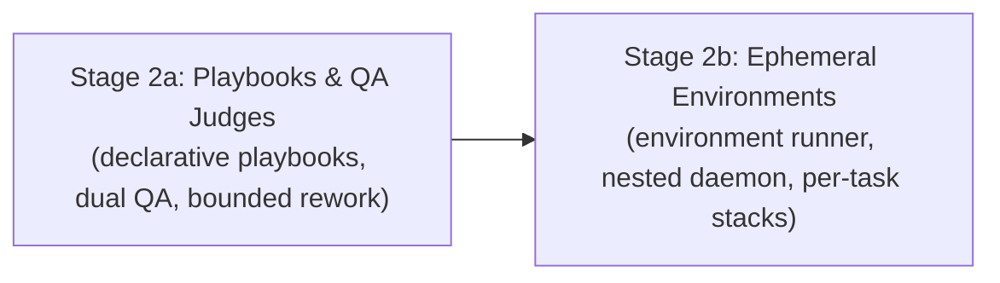

# WAVE 2 ORCHESTRATION: PLAYBOOKS, QA JUDGES & ENVIRONMENTS
## Sub-Orchestrator Execution: Stages 2a & 2b

**Applicability:** Stages 2a and 2b executed in sequential sub-waves.  
**Base Repository:** `/home/john/Projects/The-Agency/`  
**Prerequisite:** Wave 1 merged into `main` with `make accept STAGE=1d` passing.

---

## 1. Wave Architecture & Stage Dependency Chain

Wave 2 delivers the cognitive workflow and testing infrastructure:

---

## 2. Stage Execution Details

### Sub-Wave 2A: Playbooks and QA Judges (`stage-2a-playbooks-and-qa.md`)
- **Branch:** `stage-2a-playbooks` in `worktrees/wave-2a-playbooks/`
- **Focus**:
  - Declarative playbooks enforced by Dispatcher: `feature`, `bugfix`, `security`, `dep-update`, `docs`, `research`.
  - Independent QA judges: `qa-functional` and `qa-adversarial` run in separate sessions; verdicts use the unified `dispatcher/src/protocol.ts` JSON schema.
  - Architect breaks ties between judges.
  - Bounded rework state machine: 3 attempts $\rightarrow$ 1 replan $\rightarrow$ 2 attempts $\rightarrow$ halt for human intervention.
  - Acceptance checks in `scripts/accept/2a/*.sh`.
- **Triad Execution**:
  1. *Programmer*: Implements playbook runner, dual judge dispatch, bounded rework loop, unit tests, and report.
  2. *QA*: Runs `make check`, runs `make accept STAGE=2a`, and verifies red-proof sabotage (verifying defect guards D-04, D-13).
  3. *Drift Reviewer*: Follows `verify-stage.md`, confirms judge verdicts are never copied from gate results and rework caps are enforced, emits `VERDICT: PASS`.
- **Merge**: Merge `stage-2a-playbooks` into `main`.

---

### Sub-Wave 2B: Ephemeral Test Environments (`stage-2b-environments.md`)
- **Branch:** `stage-2b-environments` in `worktrees/wave-2b-environments/`
- **Focus**:
  - Environment runner service (`envrunner/`): manages per-task throwaway compose stacks.
  - Uses nested container daemon or isolated socket accessible only to the Dispatcher.
  - Lifecycle: boot task stack $\rightarrow$ wait for healthy $\rightarrow$ execute verify checks $\rightarrow$ teardown & purge volumes.
  - Acceptance checks in `scripts/accept/2b/*.sh`.
- **Triad Execution**:
  1. *Programmer*: Implements environment runner, stack lifecycle, cleanup routines, and report.
  2. *QA*: Runs `make check`, validates stack boot and cleanup, runs `make accept STAGE=2b`, and conducts red-proof sabotage.
  3. *Drift Reviewer*: Follows `verify-stage.md`, verifies container volume cleanup and isolation barriers, emits `VERDICT: PASS`.
- **Merge**: Merge `stage-2b-environments` into `main`.

---

## 3. Wave Completion Barrier
Wave 2 is certified when both sub-stages are merged to `main` and root `make check` and `make accept STAGE=2b` pass cleanly.
