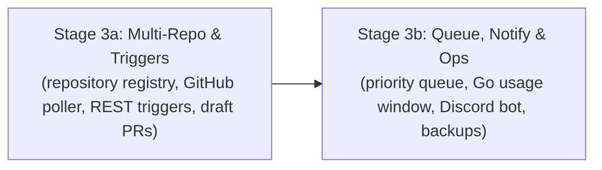

# WAVE 3 ORCHESTRATION: REGISTRY, TRIGGERS & OPERATIONS
## Sub-Orchestrator Execution: Stages 3a & 3b

**Applicability:** Stages 3a and 3b executed in sequential sub-waves.  
**Base Repository:** `/home/john/Projects/The-Agency/`  
**Prerequisite:** Wave 2 merged into `main` with `make accept STAGE=2b` passing.

---

## 1. Wave Architecture & Stage Dependency Chain

Wave 3 transforms the fleet from a single-repo engine into an always-on multi-repository operations platform:

---

## 2. Stage Execution Details

### Sub-Wave 3A: Repository Registry & Event Triggers (`stage-3a-registry-and-triggers.md`)
- **Branch:** `stage-3a-registry` in `worktrees/wave-3a-registry/`
- **Focus**:
  - Central repository registry: multiple registered target repositories, per-repo ownership maps, declared check definitions.
  - Event ingestion: REST webhook receiver, scheduled cron triggers, GitHub poller (issues and PR comments).
  - Human gating: approval-based onboarding; all GitHub-triggered plans wait for human approval.
  - Draft PR bot: opens draft PR when mission integration branch gates pass. Human merges only.
  - Acceptance checks in `scripts/accept/3a/*.sh`.
- **Triad Execution**:
  1. *Programmer*: Implements registry store, trigger adapters, GitHub poller, draft PR bot, unit tests, and report.
  2. *QA*: Runs `make check`, tests webhook and poll triggers against fake GitHub server, runs `make accept STAGE=3a`, and conducts red-proofs.
  3. *Drift Reviewer*: Follows `verify-stage.md`, verifies human-only merge policy and approval allowlists, emits `VERDICT: PASS`.
- **Merge**: Merge `stage-3a-registry` into `main`.

---

### Sub-Wave 3B: Priority Queue, Usage Windows & Operations (`stage-3b-queue-notify-ops.md`)
- **Branch:** `stage-3b-queue-ops` in `worktrees/wave-3b-queue-ops/`
- **Focus**:
  - Priority queue: orders missions across repositories by priority and arrival.
  - Usage window tracker: tracks OpenCode Go quotas ($12 per 5 hours), pauses missions at cap, resumes cleanly when window resets.
  - Multi-channel notifications: dashboard events, GitHub comments, Discord bot updates.
  - System operations: liveness/readiness probes, SQLite database snapshots, audit log rotation.
  - Acceptance checks in `scripts/accept/3b/*.sh`.
- **Triad Execution**:
  1. *Programmer*: Implements priority queue, Go quota window accounting, Discord notifier, backup scripts, and report.
  2. *QA*: Runs `make check`, tests quota exhaustion pause and resume, runs `make accept STAGE=3b`, and verifies red-proofs.
  3. *Drift Reviewer*: Follows `verify-stage.md`, verifies notification reliability and backup integrity, emits `VERDICT: PASS`.
- **Merge**: Merge `stage-3b-queue-ops` into `main`.

---

## 3. Wave Completion Barrier
Wave 3 is certified when both sub-stages are merged to `main` and root `make check` and `make accept STAGE=3b` pass cleanly.
