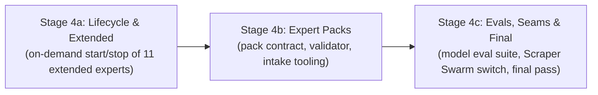

# WAVE 4 ORCHESTRATION: LIFECYCLE, PACKS & MODEL EVALS
## Sub-Orchestrator Execution: Stages 4a, 4b, 4c

**Applicability:** Stages 4a, 4b, 4c executed in sequential sub-waves.  
**Base Repository:** `/home/john/Projects/The-Agency/`  
**Prerequisite:** Wave 3 merged into `main` with `make accept STAGE=3b` passing.

---

## 1. Wave Architecture & Stage Dependency Chain

Wave 4 delivers the extended expert roster, external pack seams, and candidate model benchmarks:

---

## 2. Stage Execution Details

### Sub-Wave 4A: On-Demand Lifecycle & Extended Experts (`stage-4a-lifecycle-and-extended.md`)
- **Branch:** `stage-4a-lifecycle` in `worktrees/wave-4a-lifecycle/`
- **Focus**:
  - Dynamic container lifecycle manager: boots any of the 11 extended experts on-demand when requested by task envelope.
  - Healthcheck polling over `/api/info`, task execution, idle timeout shutdown, resource reclamation.
  - Acceptance checks in `scripts/accept/4a/*.sh`.
- **Triad Execution**:
  1. *Programmer*: Implements dynamic container manager, idle reaper, unit tests, and report.
  2. *QA*: Runs `make check`, boots extended expert dynamically, verifies task dispatch, runs `make accept STAGE=4a`, and conducts red-proofs.
  3. *Drift Reviewer*: Follows `verify-stage.md`, verifies container cleanup on timeout and error, emits `VERDICT: PASS`.
- **Merge**: Merge `stage-4a-lifecycle` into `main`.

---

### Sub-Wave 4B: Expert Pack Contract & Validator (`stage-4b-expert-packs.md`)
- **Branch:** `stage-4b-packs` in `worktrees/wave-4b-packs/`
- **Focus**:
  - Formal Pack Contract: manifest validation, host compatibility check, skill/tool definitions.
  - Pack validator CLI: verifies external packs at pinned git commits.
  - Intake tooling for donor packs (`godot-opencode`, `opencode-gdevelop`, `opencode-rea`).
  - Acceptance checks in `scripts/accept/4b/*.sh`.
- **Triad Execution**:
  1. *Programmer*: Implements pack contract validator, donor conversion scripts, unit tests, and report.
  2. *QA*: Runs `make check`, runs pack validator against fixture packs, runs `make accept STAGE=4b`, and conducts red-proofs.
  3. *Drift Reviewer*: Follows `verify-stage.md`, verifies zero unpinned external dependencies, emits `VERDICT: PASS`.
- **Merge**: Merge `stage-4b-packs` into `main`.

---

### Sub-Wave 4C: Model Eval Suite, Web Seams & Final Pass (`stage-4c-evals-seams-final.md`)
- **Branch:** `stage-4c-evals` in `worktrees/wave-4c-evals/`
- **Focus**:
  - Scripted model evaluation suite: benchmark missions on fixture repositories to measure spend, step count, and rework rates across candidate models.
  - Production Scraper Swarm cutover: switch from basic webfetch to typed MCP gateway over Smokescreen egress proxy.
  - Final acceptance pass: execute complete system acceptance suite across all stages (`STAGE=all`).
  - Acceptance checks in `scripts/accept/4c/*.sh`.
- **Triad Execution**:
  1. *Programmer*: Implements eval suite runner, Scraper Swarm client bridge, final documentation, and report.
  2. *QA*: Runs `make check`, runs eval benchmarks on fixtures, runs `make accept STAGE=all`, and proves red-proofs.
  3. *Drift Reviewer*: Follows `verify-stage.md`, conducts whole-fleet audit, emits final `VERDICT: PASS`.
- **Merge**: Merge `stage-4c-evals` into `main`.

---

## 3. Project Completion
With Wave 4 merged into `main`, The Agency (Edition 2) is complete, proven against rigorous sabotage tests, and ready for production deployment.
