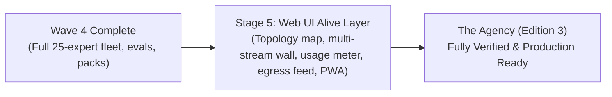

# WAVE 5 ORCHESTRATION: WEB UI ALIVE LAYER & FINAL POLISH (STAGE 5)
## Sub-Orchestrator Execution: Real-Time Telemetry, Topology, Multi-Stream Wall & PWA

**Applicability:** Stage 5 executed in isolated worktree.  
**Base Repository:** `/home/john/Projects/The-Agency/`  
**Prerequisite:** Wave 4 merged into `main` with `make accept STAGE=4c` passing.

---

## 1. Wave Architecture & Stage Mission

Wave 5 delivers the extraordinary real-time "Alive" layer for The Agency Web UI, turning the system into a living mission control:

The stage operates on its dedicated worktree, executes the full Triad protocol, is verified by the Drift Reviewer, and merges into `main`.

---

## 2. Stage Execution Details

### Stage 5: Web UI Alive Layer (`stage-5-web-ui-alive.md`)
- **Branch:** `stage-5-web-ui-alive` in `worktrees/wave-5-web-ui-alive/`
- **Focus**:
  - **Interactive Fleet Topology:** React Flow graph with dynamic health badges and animated neon particle edge flows connecting Director, Dispatcher, 25 Experts, Verifier, Environment Runner, and Egress Proxy.
  - **Multi-Expert Transcript Wall:** Live concurrent multi-stream grid supporting token-by-token SSE streaming, collapsible tool cards, and inline mini-diffs.
  - **Live Usage Ledger & Quota Countdown:** Real-time gauge of 5-hour, weekly, and monthly Go quota windows with countdown timer during pauses.
  - **Egress Proxy Stream:** Live real-time traffic feed from Squid proxy tagged by expert name with green/magenta status indicators.
  - **Audit Chain Visualizer:** Block explorer with animated block arrivals and cryptographic hash verification.
  - **PWA & Web Push:** Service worker, web manifest, standalone display mode, and push notifications for attention items (`waiting-human`).
  - **Performance Optimization:** 60fps benchmark with 14 active streams, graceful degradation mode for mobile/low-power devices, and adherence to `prefers-reduced-motion`.
  - **Automated Playwright Tests:** End-to-end browser tests verifying animations, multi-stream concurrency, mobile parity, and axe accessibility compliance.
- **Triad Execution**:
  1. *Programmer*: Implements topology canvas, multi-stream wall, usage meters, egress feed, PWA service worker, and Playwright tests.
  2. *QA*: Runs `make check`, executes `make accept STAGE=5`, verifies 60fps performance profiling, and performs red-proof sabotage.
  3. *Drift Reviewer*: Follows `verify-stage.md`, audits Playwright tests, verifies fail-closed behavior on hash tampering and PWA registration, emits `VERDICT: PASS`.
- **Merge**: Merge `stage-5-web-ui-alive` into `main`.

---

## 3. Project Completion

With Wave 5 merged into `main`:
1. Run final full-suite verification: `make check && make accept STAGE=all`.
2. All 14 stages across 6 waves are verified with binding `VERDICT: PASS` reports and red-proof logs.
3. The Agency (Edition 3) is complete, robust, and operational.
